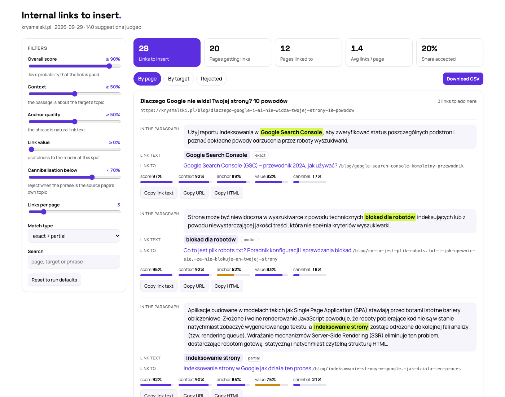

# internal-linking

Internal link suggestions for any website, in one command. The tool finds phrases that **already exist** in your content (exact or partial match of another page's name) and asks [Jev](https://openrouter.ai/) - a typed-decision model by TypeSafe, called on TypeSafe's own API or through OpenRouter - to judge every page → phrase → target pair. Every page is also turned into an embedding (Qwen3 Embedding 8B, 768 dimensions, also through OpenRouter), so each link gets a similarity score and the report can draw the whole site as an interactive graph. The output is a CMS-agnostic HTML report and CSV with links ready to insert.

> Works with Polish and English pages. The language is detected per page (`<html lang>`, or the text when the attribute is missing), so bilingual sites get links within each language version. Other languages are skipped.



Full example: [`examples/report-krysmalski.pl.html`](examples/report-krysmalski.pl.html) - a real run on a 43-page SEO blog: 28 links on 20 pages, 140 suggestions judged, $0.01. Download it and open it in a browser. (Made with 0.1.0 - no Graph view yet.)

## Changelog

### 0.3.0 - 2026-10-11
- **Insert and verify:** `links-for-agent.md` - the links with instructions for a coding agent (Claude Code, Antigravity...) that inserts them in the site's source (Astro, MDX, HTML...); `internal-linking verify` checks the result on the live site or a local preview and fills the report's new Verification tab; each `run` checks the previous list on the fresh crawl.
- **Fixed:** excerpts of posts on tag, category and blog index pages are no longer link sources (a listing of `<article>` cards is read whole); the labelling sample now shows the passage Jev judged; pages without a charset header are decoded by their `<meta charset>`.
- **Changed:** tag, author and date archives are never link targets (`archive_patterns` in `config.json`; categories still are); the report tells true orphans (no internal link at all) from pages linked only from the menu; `evaluate` gives each signal's AUC with an interval, also for page similarity, and sets a similarity threshold only when it helps; the Jev version is part of the answer cache key.

### 0.2.0 - 2026-10-10
- Page embeddings with `qwen/qwen3-embedding-8b` through OpenRouter (768 dimensions, cached) and a `similarity` score on every link, with an optional `similarity_min` threshold.
- Graph view in the report: topic map, links today and new links, click-to-focus with similarity rings, closest unlinked pages, similarity histograms. Works offline (force-graph, MIT, inlined).
- Jev on TypeSafe's own API with `TYPESAFE_API_KEY` in `.env`; when it is empty, Jev goes through OpenRouter as before.
- New `embed` command and `run --no-embeddings`; `--dry-run` also counts the pages to embed.
- Pages view: links out today and a shortcut to the graph.
- **Breaking:** `recommendations.csv` and `links.csv` have a new `similarity` column after `score`.

### 0.1.0 - 2026-09-29
- First public version: sitemap crawl, exact / partial phrase matching (Polish, English), one Jev call per pair, keyword mode, page filters, interactive report, quality tools.

## Why?

- **Links on text that is already there.** Most internal linking tools suggest "related pages" and leave it to you to find a spot, or write new sentences for you. This one only proposes a link where a matching phrase already exists, so you get the paragraph, the phrase and the target - nothing to rewrite.
- **Judged, not guessed.** Jev answers closed questions with probabilities (is the passage on topic, is the phrase a natural anchor, would the link cannibalise the source page), so decisions come from thresholds you can measure and tune instead of from reading generated prose.
- **Cheap enough for every site.** One Jev call per pair, cached between runs - a 50-page site costs about a cent.
- **Safe defaults.** No links from headings, no duplicates of existing links, no phrases repeated like a template, same language only, at most 3 new links per page.
- **See the whole structure.** Page embeddings show how close two linked pages are in meaning, which pages are close but not linked, and how the site is linked today versus after the changes - as a graph you can click through.

The default thresholds were calibrated on Polish service and blog sites; on a new kind of site (e.g. an online store) or on English pages, check a sample first (see [Thresholds and quality checks](#thresholds-and-quality-checks-optional)).

## Install

```bash
git clone https://github.com/krysmalskipl/internal-linking && cd internal-linking
python3 -m venv .venv && .venv/bin/pip install -e .
cp .env.example .env   # put your API keys in .env
```

Keys in `.env`: `OPENROUTER_API_KEY` covers both Jev and the embeddings. With `TYPESAFE_API_KEY` (from [console.typesafe.ai](https://console.typesafe.ai)) Jev is called on TypeSafe's own API instead - the same version, `jev-1.13.0`, so the thresholds and cached answers still apply - and OpenRouter is used only for the embeddings. Leave `TYPESAFE_API_KEY` empty to call Jev through OpenRouter.

On Windows (PowerShell):

```powershell
git clone https://github.com/krysmalskipl/internal-linking; cd internal-linking
py -m venv .venv; .venv\Scripts\Activate.ps1; pip install -e .
copy .env.example .env   # put your API keys in .env
```

Open a report with `open data/example.com/report.html` (macOS) or `start data\example.com\report.html` (Windows).

## Usage

```bash
internal-linking run --domain example.com
internal-linking run --domain a.com --domain b.com       # several domains
internal-linking run --domains-file domains.txt          # one domain per line
internal-linking run --domain example.com --dry-run      # count pairs and estimate cost, no Jev calls
internal-linking run --domain example.com --no-crawl     # reuse downloaded pages
internal-linking run --domain example.com --max-links 5  # new links per page (default 3)
internal-linking run --domain shop.com --targets '/category/|/blog/'   # large shop: link only to categories and posts
internal-linking run --domain shop.com --sources '^/blog/'              # only blog posts get new links (to any page)
internal-linking run --domain example.com --sources-file urls.txt        # only these pages get new links (URLs or paths, one per line)
internal-linking run --domain example.com --sources '^/blog/' --keywords services.csv   # blog → service pages on your phrases
internal-linking run --domain example.com --keywords keywords.csv   # keyword mode, see below
internal-linking run --domain example.com --no-embeddings   # skip page embeddings (no similarity, no topic map)
internal-linking embed --domain example.com              # embed the saved pages and rebuild the report - no crawl, no Jev calls
internal-linking report --domain example.com             # rebuild report.html from saved results - no crawl, no API calls
internal-linking verify --domain example.com             # are the links inserted? (see Insert and verify)
internal-linking questions --lang en                     # print the questions sent to Jev (en / pl)
```

(With the virtualenv not activated, use `.venv/bin/internal-linking`.)

Results land in `data/<domain>/` (change with `--data-dir`):
- `report.html` - an interactive, self-contained report: every link as *where* (the paragraph with the highlighted phrase), *what* (the link text) and *where to* (the target), with copy buttons for the text, the URL and ready HTML; sliders in % for every Jev score, page similarity, links per page, match type and search change the selection live; views: *Linking to* (the new links each page will get), *Linked from* (where each target's new links come from, with its links today - orphans - no internal link at all - and pages with no or few links in content flagged), *Pages* (every page with links in and out today, new links in and out, sortable by the weakest linked), *Graph* (the whole site as an interactive graph, see below), *Verification* (which links are inserted), *Keywords* and *Rejected* (with reasons); collapsible groups; light / dark switch; CSV export of the current selection
- `links.csv` - links to insert
- `links-for-agent.md` - the same links with instructions for a coding agent (see below)
- `recommendations.csv` - every judged suggestion with its decision, reason and page similarity
- `embeddings.jsonl` - one vector per page (cache)

Jev answers (`jev_pairs.jsonl`) and page embeddings (`embeddings.jsonl`) are cached, so re-runs only pay for new or changed pairs and pages. Rough numbers: a 50-page site takes about a minute and about $0.01; downloading is the slow part on large sites (about 0.5 s per page), the phrase search takes seconds thanks to a word index. `--sources` / `--targets` (regexes on the URL path) and `--sources-file` / `--targets-file` (lists of URLs or paths) choose which pages get links and which pages links may point to - the whole site is still crawled, so e.g. blog posts can link to service pages. On a shop with thousands of products they also keep the number of Jev calls - and the cost - under control; check it first with `--dry-run`.

## Insert and verify

1. **Insert** - by hand from the report, or give `links-for-agent.md` (or the report's *For AI agent (.md)* download of your current selection) to a coding agent in the site's repository: *"Insert the links from links-for-agent.md"*. It finds each passage in the source - Markdown/MDX, `.astro`, HTML, JSX - links the exact phrase in the file's own syntax and reports what it inserted or skipped.
2. **Verify** - `internal-linking verify --domain example.com --base-url http://localhost:4321` on a local preview, or without `--base-url` after deploying. For every link: inserted as proposed, another link text, another passage, only in the menu, missing, or a target that does not load. Results go to `verify.csv` and the report's *Verification* tab; the exit code is 1 when anything is off, so it can run in CI.
3. **Repeat** - the next `run` re-crawls the site, checks the previous list the same way and proposes only what is still missing.

## Keyword mode

By default the tool works out targets on its own: every page's title, H1 and slug are its keywords. With `--keywords` it links **only the phrases you list** - a keyword → URL map like the ones used in SEO audits:

```csv
keyword,target_url,match
bathroom renovation,https://example.com/bathroom-renovation/,exact
kitchen renovation,,partial
```

- `target_url` is optional - without it the target is the page whose title, H1 or slug matches the keyword best (marked "auto" in the report)
- `match`: `exact` (the whole keyword, inflection-aware) or `partial` (at least 2 of its words; default); one-word keywords are allowed here
- a plain text file with one keyword per line works too
- the same safety rules and the Jev check apply; each keyword is linked at most once per page, with no site-wide limit
- `keywords_summary.csv` and the table at the top of the report show, per keyword, where it was found, how many links it got and why the rest were rejected

## Embeddings and the link graph

Every page also gets one embedding - from its title, H1, description and the start of its content - with [`qwen/qwen3-embedding-8b`](https://openrouter.ai/qwen/qwen3-embedding-8b) through OpenRouter: 768 dimensions, `OPENROUTER_API_KEY`, cached in `embeddings.jsonl`, at most about $0.02 per 1,000 pages. They give:

- **similarity** of the source and the target page on every link - a CSV column, a slider in the report and an optional `similarity_min` threshold in `config.json` (off by default),
- the **Graph** view - the whole site on a topic map with the links today and the new links; click a page and its linked pages gather around it on similarity rings while the rest of the site moves aside, with a side panel and the closest pages that are not linked yet,
- similarity histograms of the links today and the new links.

`EMBEDDING_MODEL` / `EMBEDDING_DIMENSIONS` in `.env` change the model; `--no-embeddings` skips them. If the API fails, the run carries on without them and `internal-linking embed --domain example.com` adds them later. How it works in detail: [docs/embeddings.md](docs/embeddings.md).

## How it works

1. **Crawl** (`crawl.py`) - respects robots.txt (`Disallow`, `Crawl-delay`), reads the sitemap (from `robots.txt` or common locations) and, for each page, the title, H1, meta description, language, typed content blocks (paragraph, list item, heading...) and existing links (in content, breadcrumbs, elsewhere). Skips redirects, `noindex` and pages canonicalised elsewhere. Template blocks - text repeated verbatim across pages of the same language (top bars, sidebars, "areas we cover" sections, author bios) - are then removed from the content, so any theme works without configuration, and so are post excerpts on listings (tag, category and blog index pages, "related posts" boxes): they belong to the posts they preview.
2. **Phrases** (`anchors.py`) - searches paragraphs and list items (never headings) for phrases matching another page's title, H1 or slug, inflection-aware, with per-language lists of function words and title fillers:
   - `exact` - the phrase covers the target's full name,
   - `partial` - at least two words of the target's name, including a distinctive one,
   - existing link text and code are never used; no single words or generic fillers.
3. **Rules** (`pipeline.py`) - no targets the page already links to (template links - menu, footer, sidebars, counted per language version - don't count), no target whose title or H1 is shared by several pages (e.g. the brand name as H1), same language only, no phrases repeated like a template (e.g. an author byline), a phrase that is the exact name of another page is reserved for that page; listings are never sources, and tag, author and date archives never targets (`archive_patterns` in `config.json`).
4. **Embeddings** (`embeddings.py`) - one vector per page, cached; the similarity of the two pages goes on every pair ([details](docs/embeddings.md)).
5. **Jev** (`jev/pairs.py`) - one call per pair, with the source page, the section heading, the passage and its neighbouring passages, and the target page; closed questions: does the paragraph discuss the target's topic, is the phrase a natural anchor, link value (0-4), cannibalisation, overall verdict with a reason code. Inspired by the Jev mode in [newsjack](https://github.com/elvisun/newsjack). Print the questions with `internal-linking questions`.
6. **Selection** - thresholds from `config.json` (shared by all domains), one link per phrase, at most N links per page by score.
7. **Report** (`report.py`) - the HTML report with the graph data (pages, links today, topic map, closest pages) built in.

## Thresholds and quality checks (optional)

The default thresholds (`src/internal_linking/config.json`) were set on hand-labelled samples. A `config.json` in the working directory, or `--config`, overrides them. To check or retune them on your own sites:

```bash
internal-linking sample --domain example.com      # random sample of suggestions
internal-linking label --domain example.com       # label Yes / No in the browser (localhost:8765)
internal-linking evaluate --domain example.com --write-config   # signal AUC and new thresholds → ./config.json
```

`evaluate` prints each signal's AUC with a 90% interval - also for page similarity - and the precision per match type; aim for 50+ labels, a wide interval means more are needed. A similarity threshold is only set when it accepts more good links at the target precision.

## Project layout

```
src/internal_linking/
├── cli.py            # `internal-linking` command
├── pipeline.py       # candidates (automatic and keyword mode), rules, selection
├── keywords.py       # keyword list loading, target auto-pick
├── crawl.py          # sitemap, robots.txt, content blocks, existing links
├── anchors.py        # exact / partial phrase matching, language detection
├── embeddings.py     # page embeddings (Qwen3 Embedding 8B via OpenRouter), similarity, topic map, `embed` command
├── report.py         # interactive report.html with the Graph and Verification views, `report` command
├── agent.py          # links-for-agent.md for a coding agent
├── verify.py         # `verify`: are the links on the site
├── vendor/           # force-graph (MIT), inlined into the report
├── config.py         # thresholds (config.json)
├── jev/client.py     # API client: Jev on TypeSafe or OpenRouter, POST with retries
├── jev/pairs.py      # questions per pair, answer → columns, hard rules
└── quality/          # sample, label, evaluate
tests/                # pytest, no network: pip install -e ".[dev]" && pytest
```

## Notes

- The API client is `jev/client.py`: Jev `jev-1.13.0` on TypeSafe's `/v1/systemone` when `TYPESAFE_API_KEY` is set (`TYPESAFE_MODEL` / `TYPESAFE_API_URL` override it), otherwise `typesafe/jev-1.13` on OpenRouter's alpha decisions endpoint, which may change (`JEV_MODEL` / `JEV_API_URL`). TypeSafe's own API may not report a cost per call - the report then says "billed by TypeSafe". Keep a pinned version rather than `jev-latest`: answers are cached per version and the thresholds were set on 1.13, while the alias moves without changing its name.
- The crawler identifies itself as `internal-linking`, respects robots.txt and waits 0.5 s between requests by default (`--delay`). Only run it on sites you own or have permission to analyse.

## License

MIT
