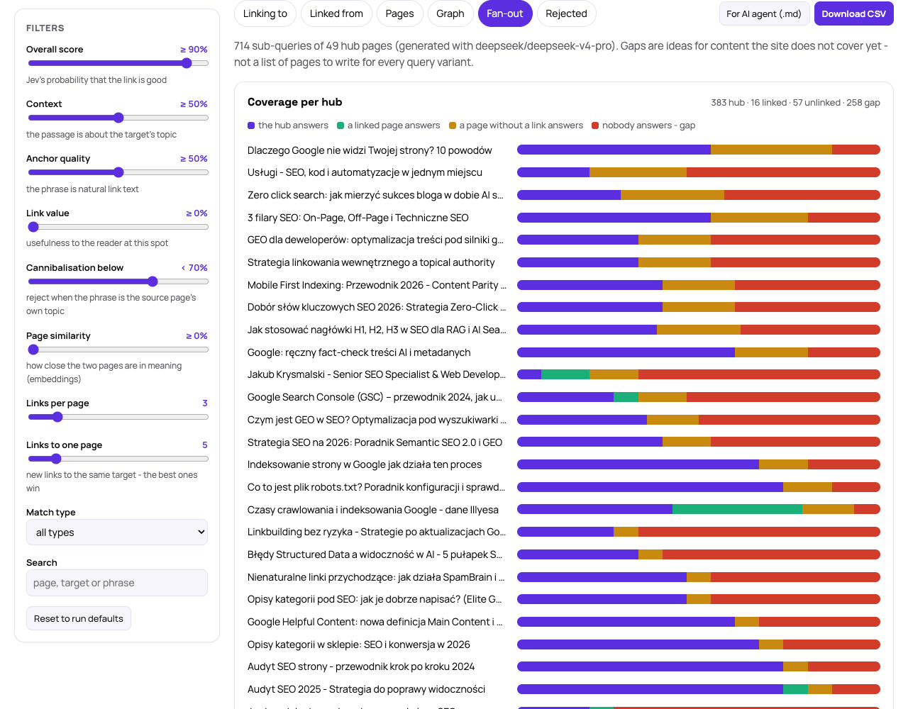

# internal-linking

Internal link suggestions for any website, in one command. The tool finds phrases that **already exist** in your content (exact or partial match of another page's name) and asks [Jev](https://openrouter.ai/typesafe/jev-1.13) - a typed-decision model by TypeSafe, called on TypeSafe's own API or through OpenRouter - to judge every page → phrase → target pair. Every page is also turned into an embedding (Qwen3 Embedding 8B, 768 dimensions, also through OpenRouter), so each link gets a similarity score and the report can draw the whole site as an interactive graph. The output is a CMS-agnostic HTML report and CSV with links ready to insert.

> Works with Polish and English pages. The language is detected per page (`<html lang>`, or the text when the attribute is missing), so bilingual sites get links within each language version. Other languages are skipped.


Full example: [`examples/report-krysmalski.pl.html`](examples/report-krysmalski.pl.html) - a real run on a 43-page SEO blog: 28 links on 20 pages, 140 suggestions judged, $0.01. Download it and open it in a browser. (Made with 0.1.0 - no Graph view yet.)

## Changelog

### 0.6.1 - 2026-10-12
- **Broken internal links:** every `run` checks the links in the content that point to pages of the site outside the crawl - one request each, cached for a week, `--no-link-check` skips it. A 404, a 410 or a "soft 404" (a 200 page titled "not found", as many CMSs serve for a missing post) is listed with the page the link was meant for (by its text and the old address), in `broken_links.csv`, a *Broken links* tab in the report and a *Broken links to repair* section in `links-for-agent.md`. A new link for the same pair is not proposed - the old one is repaired.
- **Better link text for fan-out and semantic links:** a phrase starts and ends on a word that can name a topic - no Polish infinitive ("rozróżnić naturalne linki…"), no short lower-case word ("Zasięg vs"); words count as shared with the target only in an inflected form, not by a common stem ("Strategiczne" ≠ "Strategia"); Jev is asked for a phrase naming the target's topic, not an action.
- **A stricter bar for links found by meaning:** `meaning_score_min` (0.93, a slider in the report) on top of the usual thresholds.
- **Benchmark:** the fan-out and semantic pairs of the hand-labelled run are part of `tests/benchmark/` - the candidates found, the Jev answers and a label per pair; the test fails if a good pair stops reaching Jev or the picked links lose precision.

  On that run, against the hand labels: the 6 fan-out and semantic links went from 2 good (33%) to 2 links, both good; the other 4 are gone - 3 lost their bad link text, 1 is now the repair of a broken link. All 4 good pairs still reach Jev. The threshold was set on these 29 pairs, so treat it as a first guess.

### 0.6.0 - 2026-10-12
- **Query fan-out** (`run --fanout`, off by default): for the hub pages - the best linked content pages, or the ones you pick - the tool gets the searches each page and its neighbours should answer: real queries from a Search Console export (`--gsc`, optional) and 10-15 sub-queries from a model on OpenRouter (`FANOUT_MODEL`, `deepseek/deepseek-v4-pro` by default, about $0.0003 per hub, cached). Every sub-query is matched to the site's paragraphs: the hub answers it, a page it links to does, a page it does not link to does - a **link** - or nobody does - a **content gap**. See [Fan-out](#query-fan-out).
- **Semantic phrases** (`run --semantic`): links to pages from paragraphs close to them in meaning, also when the text never names them.
- Both find pages phrase matching cannot - nobody names them - and go through the same Jev judgement, thresholds and limits. Jev picks the link text among the paragraph's own phrases.
- New: `fanout.csv`, `fanout_gaps.csv`, a *Fan-out* tab in the report and the panel (coverage per hub, sub-queries with filters, the links found), match types `fanout` / `semantic`, `passage_similarity` and `subquery` columns (at the end of the CSV files), paragraph embeddings cached in `passages.jsonl`.
- `evaluate` measures fan-out and semantic pairs on their own (precision, AUC of `passage_similarity`) and keeps them out of the threshold search; `sample --anchor-type fanout` draws only them.
- Phrase matching is unchanged: the benchmark gives the same 230 pairs and 90% precision.

  First run on the hand-labelled 63-page blog (49 hubs, no Search Console data): 714 sub-queries - the hub answers 383, a page it links to 16, a page it does not link to 57, nobody 258; 29 new pairs judged, 6 more links (5 semantic, 1 fan-out), none of the phrase-matched links lost; $0.015 for the sub-queries and $0.003 for 1,558 paragraph embeddings. Not hand-labelled yet - check a sample before relying on them.

### 0.5.1 - 2026-10-11
- **Cleaner phrases, fewer paid calls:**
  - a phrase never runs into a bracket or a quote ("indexing (does Google" → "indexing");
  - a partial phrase never spans a conjunction ("ChatGPT or Gemini"); a full page name may;
  - the first and last word of a partial phrase must be the target's own word, not just a shared stem;
  - text outside any paragraph, list or table (FAQ toggles, copy buttons, tables built from divs) is no longer a link source.
  
  On a hand-labelled 63-page blog this sends 230 pairs to Jev instead of 268 (44 bad ones gone, no good one lost), precision 19/21 (was 19/22), and two good links lost to a badly cut phrase come back.
- **Benchmark:** `tests/benchmark/` holds that real run (pages, Jev answers, every judged pair labelled by hand); a test replays it without network and fails if a change loses a good pair, lowers precision below 90% or sends more pairs to Jev. `python tests/bench.py <folder>` prints the numbers.

### 0.5.0 - 2026-10-11
- **Clear errors:** every command ends with `! what went wrong - what to do` and exit code 1 instead of a Python trace: no results yet ("run `internal-linking run` first"), a missing file, a bad `--sources` regex, a broken `config.json`, a domain that does not answer, no sitemap, a sitemap whose pages cannot be used (with the reason: robots.txt, noindex, redirects...). `--debug` shows the trace; anything unexpected asks to be reported.
- **No money spent on failing calls:** a bad key, no credits or a wrong model (401/402/403/404) stops the run after the first answer instead of sending every pair; Ctrl+C cancels the queued calls (answers already received stay cached); a 429 waits as long as the API asks (`Retry-After`); a malformed answer is not cached.
- `run` exits with code 1 when a domain fails, so scripts - and the panel - see it; failed commands show as "failed" in the panel.
- Files that are not web pages (PDF...) in the sitemap are skipped; the crawler's user agent carries the real version.
- Windows: config and domain files are read as UTF-8, uploads in the panel work.
- `scipy` is a declared dependency; tests run on Python 3.10-3.13 on Linux, macOS and Windows in CI.

### 0.4.1 - 2026-10-11
- **At most 5 new links to one page** (`max_links_per_target` in `config.json`, 0 = no limit; a slider in the report). A page named in many texts - say a Google Search Console guide on an SEO blog - got a link from nearly every post with the same anchor; now it gets the best ones (score, then how closely the passage is about it), and the rest are in *Rejected* as "per-target limit". Keyword mode is not limited.
- Panel: the *Run* form shows only the sitemap; page choice, options, limits and speed are under *Advanced*, which shows how many are changed and has *Back to defaults*. The same for the delay in *Verify* and the port in *Quality*.

### 0.4.0 - 2026-10-11
- **Panel:** `internal-linking ui` opens a local page in the browser to run everything by clicking, on the files in `data/`: domains with their last run and how many links are inserted, run / embed / report / verify / sample / evaluate / label with options and the output live, verification results with filters, files and past runs, API keys (saved to `.env`, never shown back) and thresholds. Nothing new to install.
- Every job started from the panel keeps its output in `data/<domain>/logs/`.
- `verify --links latest` takes the newest `links-for-agent-<domain>-….md` from `~/Downloads`; a missing file gives a message with the link lists in that folder instead of an error trace.

### 0.3.1 - 2026-10-11
- Timestamps: the report header shows when the run was made (and when the report was rebuilt, if later), `links-for-agent.md` when it was generated and from which run, and files downloaded from the report carry the date and time in their names (`links-for-agent-example.com-2026-10-11-1312.md`).
- `run.json` keeps each run's time and costs, so `report`, `embed` and `verify` rebuild the report without losing the Jev cost.

### 0.3.0 - 2026-10-11
- **Insert and verify:** `links-for-agent.md` - the links with instructions for a coding agent (Claude Code, Antigravity...) that inserts them in the site's source (Astro, MDX, HTML...); `internal-linking verify` checks the result on the live site or a local preview and fills the report's new Verification tab; each `run` checks the previous list on the fresh crawl.
- **Fixed:** excerpts of posts on tag, category and blog index pages are no longer link sources (a listing of `<article>` cards is read whole); the labelling sample now shows the passage Jev judged; pages without a charset header are decoded by their `<meta charset>`.
- **Changed:** tag, author and date archives are never link targets (`archive_patterns` in `config.json`; categories still are); the report tells true orphans (no internal link at all) from pages linked only from the menu; `evaluate` gives each signal's AUC with an interval, also for page similarity, and sets a similarity threshold only when it helps; the Jev version is part of the answer cache key.

### 0.2.0 - 2026-10-10
- Page embeddings with `qwen/qwen3-embedding-8b` through OpenRouter (768 dimensions, cached) and a `similarity` score on every link, with an optional `similarity_min` threshold.
- Graph view in the report: topic map, links today and new links, click-to-focus with similarity rings, closest unlinked pages, similarity histograms. Works offline (force-graph, MIT, inlined).
- Jev on TypeSafe's own API with `TYPESAFE_API_KEY` in `.env`; when it is empty, Jev goes through OpenRouter as before.
- New `embed` command and `run --no-embeddings`; `--dry-run` also counts the pages to embed.
- Pages view: links out today and a shortcut to the graph.
- **Breaking:** `recommendations.csv` and `links.csv` have a new `similarity` column after `score`.

### 0.1.0 - 2026-09-29
- First public version: sitemap crawl, exact / partial phrase matching (Polish, English), one Jev call per pair, keyword mode, page filters, interactive report, quality tools.

## Why?

- **Links on text that is already there.** Most internal linking tools suggest "related pages" and leave it to you to find a spot, or write new sentences for you. This one only proposes a link where a matching phrase already exists, so you get the paragraph, the phrase and the target - nothing to rewrite.
- **Judged, not guessed.** Jev answers closed questions with probabilities (is the passage on topic, is the phrase a natural anchor, would the link cannibalise the source page), so decisions come from thresholds you can measure and tune instead of from reading generated prose.
- **Cheap enough for every site.** One Jev call per pair, cached between runs - a 50-page site costs about a cent.
- **Questions, not just names.** With `--fanout` the tool asks which searches each important page should answer, finds the page that answers each, and proposes the missing links - and lists the questions nobody on the site answers.
- **Safe defaults.** No links from headings, no duplicates of existing links, no phrases repeated like a template, same language only, at most 3 new links per page and 5 new links to one page.
- **See the whole structure.** Page embeddings show how close two linked pages are in meaning, which pages are close but not linked, and how the site is linked today versus after the changes - as a graph you can click through.

The default thresholds were calibrated on Polish service and blog sites and are checked on every change against a hand-labelled run (`tests/benchmark/`); on a new kind of site (e.g. an online store) or on English pages, check a sample first (see [Thresholds and quality checks](#thresholds-and-quality-checks-optional)).

## Install

You need Python 3.10 or newer and an [OpenRouter](https://openrouter.ai) account with a few dollars of credit (a 50-page site costs about a cent).

```bash
python3 -m venv .venv && .venv/bin/pip install "git+https://github.com/krysmalskipl/internal-linking"
echo "OPENROUTER_API_KEY=sk-or-..." > .env   # your key, in the folder you run the tool from
.venv/bin/internal-linking ui                # the panel opens in the browser
```

To change the code, clone it instead:

```bash
git clone https://github.com/krysmalskipl/internal-linking && cd internal-linking
python3 -m venv .venv && .venv/bin/pip install -e ".[dev]"
cp .env.example .env   # put your API keys in .env
```

Keys in `.env`: `OPENROUTER_API_KEY` covers both Jev and the embeddings. With `TYPESAFE_API_KEY` (from [console.typesafe.ai](https://console.typesafe.ai)) Jev is called on TypeSafe's own API instead - the same version, `jev-1.13.0`, so the thresholds and cached answers still apply - and OpenRouter is used only for the embeddings. Leave `TYPESAFE_API_KEY` empty to call Jev through OpenRouter.

On Windows (PowerShell):

```powershell
py -m venv .venv; .venv\Scripts\pip install "git+https://github.com/krysmalskipl/internal-linking"
Set-Content .env "OPENROUTER_API_KEY=sk-or-..."
.venv\Scripts\internal-linking ui
```

(`.venv\Scripts\Activate.ps1` may need `Set-ExecutionPolicy -Scope CurrentUser RemoteSigned` once; calling `.venv\Scripts\internal-linking` directly does not.)

Open a report with `open data/example.com/report.html` (macOS), `xdg-open data/example.com/report.html` (Linux) or `start data\example.com\report.html` (Windows) - or from the panel.

## Usage

```bash
internal-linking ui                                      # the panel in the browser (see Panel)
internal-linking run --domain example.com
internal-linking run --domain a.com --domain b.com       # several domains
internal-linking run --domains-file domains.txt          # one domain per line
internal-linking run --domain example.com --dry-run      # count pairs and estimate cost, no Jev calls (pages are still downloaded)
internal-linking run --domain example.com --no-crawl     # reuse downloaded pages
internal-linking run --domain example.com --max-links 5  # new links per page (default 3)
internal-linking run --domain shop.com --targets '/category/|/blog/'   # large shop: link only to categories and posts
internal-linking run --domain shop.com --sources '^/blog/'              # only blog posts get new links (to any page)
internal-linking run --domain example.com --sources-file urls.txt        # only these pages get new links (URLs or paths, one per line)
internal-linking run --domain example.com --sources '^/blog/' --keywords services.csv   # blog → service pages on your phrases
internal-linking run --domain example.com --keywords keywords.csv   # keyword mode, see below
internal-linking run --domain example.com --no-embeddings   # skip page embeddings (no similarity, no topic map)
internal-linking run --domain example.com --fanout --dry-run   # query fan-out: what it would cost (see Query fan-out)
internal-linking run --domain example.com --fanout --gsc gsc.csv   # fan-out with your Search Console queries
internal-linking run --domain example.com --semantic        # also links from paragraphs close in meaning
internal-linking embed --domain example.com              # embed the saved pages and rebuild the report - no crawl, no Jev calls
internal-linking report --domain example.com             # rebuild report.html from saved results - no crawl, no API calls
internal-linking verify --domain example.com             # are the links inserted? (see Insert and verify)
internal-linking questions --lang en                     # print the questions sent to Jev (en / pl)
```

(With the virtualenv not activated, use `.venv/bin/internal-linking`.)

Results land in `data/<domain>/` (change with `--data-dir`):
- `report.html` - an interactive, self-contained report: every link as *where* (the paragraph with the highlighted phrase), *what* (the link text) and *where to* (the target), with copy buttons for the text, the URL and ready HTML; sliders in % for every Jev score, page similarity, links per page, links to one page, match type and search change the selection live; views: *Linking to* (the new links each page will get), *Linked from* (where each target's new links come from, with its links today - orphans - no internal link at all - and pages with no or few links in content flagged), *Pages* (every page with links in and out today, new links in and out, sortable by the weakest linked), *Graph* (the whole site as an interactive graph, see below), *Verification* (which links are inserted), *Keywords* and *Rejected* (with reasons); collapsible groups; light / dark switch; CSV export of the current selection
- `links.csv` - links to insert
- `links-for-agent.md` - the same links with instructions for a coding agent (see below)
- `run.json` - when the run was made and what it cost
- `recommendations.csv` - every judged suggestion with its decision, reason and page similarity
- `embeddings.jsonl` - one vector per page (cache)
- `broken_links.csv` - links in the content to pages that no longer load, with the page each was meant for (also in the report and `links-for-agent.md`)
- with `--fanout`: `fanout.csv` (every sub-query of every hub, who answers it and what became of the link) and `fanout_gaps.csv` (the questions nobody on the site answers); `fanout.jsonl` and `passages.jsonl` are caches

Jev answers (`jev_pairs.jsonl`) and page embeddings (`embeddings.jsonl`) are cached, so re-runs only pay for new or changed pairs and pages. Rough numbers: a 50-page site takes about a minute and about $0.01; downloading is the slow part on large sites (about 0.5 s per page), the phrase search takes seconds thanks to a word index. `--sources` / `--targets` (regexes on the URL path) and `--sources-file` / `--targets-file` (lists of URLs or paths) choose which pages get links and which pages links may point to - the whole site is still crawled, so e.g. blog posts can link to service pages. On a shop with thousands of products they also keep the number of Jev calls - and the cost - under control; check it first with `--dry-run`.

## Limitations

- **Only text that is already there.** By default a link needs a phrase naming the target. `--fanout` and `--semantic` also find paragraphs that are about a page without naming it - but the link text is still a phrase from that paragraph; nothing is written for you. A page nobody writes about gets no links - the fan-out gaps say what to write.
- **Polish and English.** Pages in other languages are skipped.
- **A sitemap is required** (from robots.txt, `/sitemap.xml`, `/sitemap_index.xml`, `/wp-sitemap.xml`, or `--sitemap`); the crawler does not follow links. Sites are fetched over https.
- **Content rendered by JavaScript is not seen** - only the HTML the server sends.
- **No page limit.** A large site takes time to download (about 0.5 s per page); limit the work with `--sources` / `--targets` and check the cost with `--dry-run` first.
- **Measured, not perfect.** On hand-labelled runs of two Polish sites - a 63-page SEO blog and a 24-page beauty clinic - 9 in 10 links picked with the default thresholds were ones an editor would insert (19 of 21 and 9 of 10). English pages were not measured on a real site. Check a sample on your own site (see [Thresholds and quality checks](#thresholds-and-quality-checks-optional)).

## Insert and verify

1. **Insert** - by hand from the report, or give `links-for-agent.md` (or the report's *For AI agent (.md)* download of your current selection) to a coding agent in the site's repository: *"Insert the links from links-for-agent.md"*. It finds each passage in the source - Markdown/MDX, `.astro`, HTML, JSX - links the exact phrase in the file's own syntax and reports what it inserted or skipped.
2. **Verify** - `internal-linking verify --domain example.com --base-url http://localhost:4321` on a local preview, or without `--base-url` after deploying. For every link: inserted as proposed, another link text, another passage, only in the menu, missing, or a target that does not load. Results go to `verify.csv` and the report's *Verification* tab; the exit code is 1 when anything is off, so it can run in CI. It checks `links-for-agent.md` from the last run; for a file downloaded from the report, add `--links latest` (the newest one in `~/Downloads`) or `--links <path>`.
3. **Broken links** - `run` also checks the links already in your content that point to pages of the site outside the crawl. A 404, 410 or a "not found" page served with 200 is listed with the page it was most likely meant for (the link text and the old slug usually still name it): repair the address rather than adding a second link - the agent file lists these repairs too, and the tool does not propose a new link for the same pair.
4. **Repeat** - the next `run` re-crawls the site, checks the previous list the same way and proposes only what is still missing.

## Panel

```bash
internal-linking ui                 # http://127.0.0.1:8770, opens in the browser
internal-linking ui --port 8800 --no-browser
```

Everything from the command line, by clicking: add a domain, start a run with its options, watch the output live and open the report; verify the links on a local preview or the live site and filter the results; draw a labelling sample, label it and evaluate the thresholds; download any file from `data/<domain>/` and read past runs. *Settings* saves the API keys to `.env` and the thresholds to `config.json` in the folder the panel was started from. The panel runs the same commands as the terminal, one at a time per domain, and keeps their output in `data/<domain>/logs/`.

It listens only on 127.0.0.1, accepts actions only from its own page, never sends a saved key back to the browser (only its last characters) and serves files only from `data/`. Stop it with Ctrl+C.

## Keyword mode

By default the tool works out targets on its own: every page's title, H1 and slug are its keywords. With `--keywords` it links **only the phrases you list** - a keyword → URL map like the ones used in SEO audits:

```csv
keyword,target_url,match
bathroom renovation,https://example.com/bathroom-renovation/,exact
kitchen renovation,,partial
```

- `target_url` is optional - without it the target is the page whose title, H1 or slug matches the keyword best (marked "auto" in the report)
- `match`: `exact` (the whole keyword, inflection-aware) or `partial` (at least 2 of its words; default); one-word keywords are allowed here
- a plain text file with one keyword per line works too
- the same safety rules and the Jev check apply; each keyword is linked at most once per page, with no site-wide limit
- `keywords_summary.csv` and the table at the top of the report show, per keyword, where it was found, how many links it got and why the rest were rejected

## Query fan-out



Phrase matching only links a page where its name appears in the text, so the pages that need links most - the ones nobody mentions - get none. Fan-out starts from questions instead:

1. **Hubs** - the content pages that are best linked today (not listings or archives, at least `min_words`), up to `--fanout-max` (100); or your choice: `--fanout-pages '^/blog/'` (a regex on the path) or `--fanout-pages-file hubs.txt` (URLs or paths).
2. **Sub-queries** - for each hub, the real queries of that page from a Search Console export (`--gsc`, top 30 by impressions; optional) and 10-15 sub-queries from a model - the searches a person interested in the topic also makes: related subtopics, comparisons, costs, how-to steps, who it is for, local intent. Search Console queries come first; a generated one that means the same is merged into it.
3. **Who answers** - every paragraph of the site gets an embedding (Qwen3 Embedding 8B, like the pages; the sub-queries are embedded as search queries). For each sub-query: *the hub answers it*, *a page the hub links to answers it*, *a page the hub does not link to answers it* → a link from the hub's paragraph closest to the question, or *nobody answers it* → a content gap.
4. **Links** - Jev picks the link text among the phrases of 2-6 words in that paragraph (or none, when no phrase announces the target), then judges the pair like any other: same thresholds, one link per phrase, the per-page and per-target limits. They show as match type `fanout`, with the sub-query and the paragraph similarity.

**Gaps are ideas, not a page list.** A question nobody on the site answers may deserve a section in the hub, a new article, or nothing. Writing a page for every variant of a query is what Google's guidelines warn against; the gaps are there to decide which questions your readers actually need answered.

`--semantic` does the same without sub-queries: each page's name is matched to the paragraphs of other pages, so a page can get a link from text that is about it without naming it.

**Search Console data** - a CSV with a page and a query column; clicks and impressions are used when present. Column names in English or Polish (`Page`/`URL`/`Strona`, `Query`/`Zapytanie`, `Clicks`/`Kliknięcia`, `Impressions`/`Wyświetlenia`), comma or semicolon separated. The export from the Search Console interface does **not** pair pages with queries (the *Queries* and *Pages* tabs are separate tables), so get it from:
- [Search Analytics for Sheets](https://searchanalyticsforsheets.com/) - group by *Page* and *Query*, then *File → Download → CSV*,
- the Search Console **bulk export to BigQuery** - the `searchdata_url_impression` table (`url`, `query`, `clicks`, `impressions`; daily rows are summed),
- the Search Console API (`searchanalytics.query` with dimensions `page` and `query`).

Without `--gsc` everything works on the generated sub-queries alone.

**Cost** - one model call per hub (about $0.0003 with DeepSeek V4 Pro, $0.002 with Gemini 3.8 Flash; `FANOUT_MODEL` in `.env` picks any OpenRouter chat model with JSON output - the call goes to the cheapest provider that supports it, with reasoning off or at its minimum), the paragraph embeddings (about $0.002 per 1,000 paragraphs) and two Jev calls per link found (at most 6 per hub). A 60-page blog with every content page as a hub is a few cents. Everything is cached - in `fanout.jsonl`, `passages.jsonl` and `jev_anchors.jsonl` - so a second run pays only for what changed; `--dry-run` shows the count first.

**Measured separately.** Fan-out and semantic links are new: they must also reach `meaning_score_min` (0.93) - a stricter Jev score than phrase-matched links, set on 29 hand-labelled pairs. `sample --anchor-type fanout` draws only them for labelling and `evaluate` reports their precision and the AUC of the paragraph similarity on their own, outside the threshold search. The thresholds that decide whether a paragraph answers a question (`fanout_answer_min`), when a generated query is a Search Console one (`fanout_merge_min`) and how close a paragraph must be for a semantic link (`semantic_min`) are in `config.json`.

## Embeddings and the link graph

Every page also gets one embedding - from its title, H1, description and the start of its content - with [`qwen/qwen3-embedding-8b`](https://openrouter.ai/qwen/qwen3-embedding-8b) through OpenRouter: 768 dimensions, `OPENROUTER_API_KEY`, cached in `embeddings.jsonl`, at most about $0.02 per 1,000 pages. They give:

- **similarity** of the source and the target page on every link - a CSV column, a slider in the report and an optional `similarity_min` threshold in `config.json` (off by default),
- the **Graph** view - the whole site on a topic map with the links today and the new links; click a page and its linked pages gather around it on similarity rings while the rest of the site moves aside, with a side panel and the closest pages that are not linked yet,
- similarity histograms of the links today and the new links.

`EMBEDDING_MODEL` / `EMBEDDING_DIMENSIONS` in `.env` change the model; `--no-embeddings` skips them. If the API fails, the run carries on without them and `internal-linking embed --domain example.com` adds them later. How it works in detail: [docs/embeddings.md](docs/embeddings.md).

## How it works

1. **Crawl** (`crawl.py`) - respects robots.txt (`Disallow`, `Crawl-delay`), reads the sitemap (from `robots.txt` or common locations) and, for each page, the title, H1, meta description, language, typed content blocks (paragraph, list item, heading...) and existing links (in content, breadcrumbs, elsewhere). Skips redirects, `noindex` and pages canonicalised elsewhere. Template blocks - text repeated verbatim across pages of the same language (top bars, sidebars, "areas we cover" sections, author bios) - are then removed from the content, so any theme works without configuration, and so are post excerpts on listings (tag, category and blog index pages, "related posts" boxes): they belong to the posts they preview.
2. **Phrases** (`anchors.py`) - searches paragraphs and list items (never headings) for phrases matching another page's title, H1 or slug, inflection-aware, with per-language lists of function words and title fillers:
   - `exact` - the phrase covers the target's full name,
   - `partial` - at least two words of the target's name, including a distinctive one,
   - existing link text and code are never used; no single words or generic fillers.
3. **Rules** (`pipeline.py`) - no targets the page already links to (template links - menu, footer, sidebars, counted per language version - don't count), no target whose title or H1 is shared by several pages (e.g. the brand name as H1), same language only, no phrases repeated like a template (e.g. an author byline), a phrase that is the exact name of another page is reserved for that page; listings are never sources, and tag, author and date archives never targets (`archive_patterns` in `config.json`).
4. **Embeddings** (`embeddings.py`) - one vector per page, cached; the similarity of the two pages goes on every pair ([details](docs/embeddings.md)).
5. **Jev** (`jev/pairs.py`) - one call per pair, with the source page, the section heading, the passage and its neighbouring passages, and the target page; closed questions: does the paragraph discuss the target's topic, is the phrase a natural anchor, link value (0-4), cannibalisation, overall verdict with a reason code. Inspired by the Jev mode in [newsjack](https://github.com/elvisun/newsjack). Print the questions with `internal-linking questions`.
6. **Selection** - thresholds from `config.json` (shared by all domains), one link per phrase, at most N links per page and M new links to one page (`max_links_per_target`, 5; 0 = no limit), best score first.
7. **Report** (`report.py`) - the HTML report with the graph data (pages, links today, topic map, closest pages) built in.

## Thresholds and quality checks (optional)

The default thresholds (`src/internal_linking/config.json`) were set on hand-labelled samples. A `config.json` in the working directory, or `--config`, overrides them. To check or retune them on your own sites:

```bash
internal-linking sample --domain example.com      # random sample of suggestions
internal-linking label --domain example.com       # label Yes / No in the browser (localhost:8765)
internal-linking evaluate --domain example.com --write-config   # signal AUC and new thresholds → ./config.json
```

`evaluate` prints each signal's AUC with a 90% interval - also for page similarity - and the precision per match type; aim for 50+ labels, a wide interval means more are needed. A similarity threshold is only set when it accepts more good links at the target precision.

## Project layout

```
src/internal_linking/
├── cli.py            # `internal-linking` command
├── pipeline.py       # candidates (automatic and keyword mode), rules, selection
├── keywords.py       # keyword list loading, target auto-pick
├── crawl.py          # sitemap, robots.txt, content blocks, existing links
├── anchors.py        # exact / partial phrase matching, language detection
├── embeddings.py     # page embeddings (Qwen3 Embedding 8B via OpenRouter), similarity, topic map, `embed` command
├── passages.py       # paragraph embeddings, queries matched to paragraphs, phrases in a paragraph
├── fanout.py         # query fan-out: hubs, Search Console import, sub-queries, coverage, semantic phrases
├── broken.py         # broken internal links in the content and the page each was meant for
├── report.py         # interactive report.html with the Graph and Verification views, `report` command
├── agent.py          # links-for-agent.md for a coding agent
├── verify.py         # `verify`: are the links on the site
├── ui/               # `ui`: the panel - local server (server.py) and page (index.html, app.js, app.css)
├── vendor/           # force-graph (MIT), inlined into the report
├── config.py         # thresholds (config.json)
├── jev/client.py     # API client: Jev on TypeSafe or OpenRouter, POST with retries
├── jev/pairs.py      # questions per pair, answer → columns, hard rules
└── quality/          # sample, label, evaluate
tests/                # pytest, no network: pip install -e ".[dev]" && pytest
tests/benchmark/      # a real run with hand labels, replayed by tests/bench.py on every change
```

## Notes

- The API client is `jev/client.py`: Jev `jev-1.13.0` on TypeSafe's `/v1/systemone` when `TYPESAFE_API_KEY` is set (`TYPESAFE_MODEL` / `TYPESAFE_API_URL` override it), otherwise `typesafe/jev-1.13` on OpenRouter's alpha decisions endpoint, which may change (`JEV_MODEL` / `JEV_API_URL`). TypeSafe's own API may not report a cost per call - the report then says "billed by TypeSafe". Keep a pinned version rather than `jev-latest`: answers are cached per version and the thresholds were set on 1.13, while the alias moves without changing its name.
- The crawler identifies itself as `internal-linking`, respects robots.txt and waits 0.5 s between requests by default (`--delay`). Only run it on sites you own or have permission to analyse.
- **When something goes wrong** the command prints `! what happened - what to do` and exits with code 1 (130 after Ctrl+C). Run it again with `--debug` for the full trace, and report anything unexpected at [GitHub issues](https://github.com/krysmalskipl/internal-linking/issues).

## License

MIT
